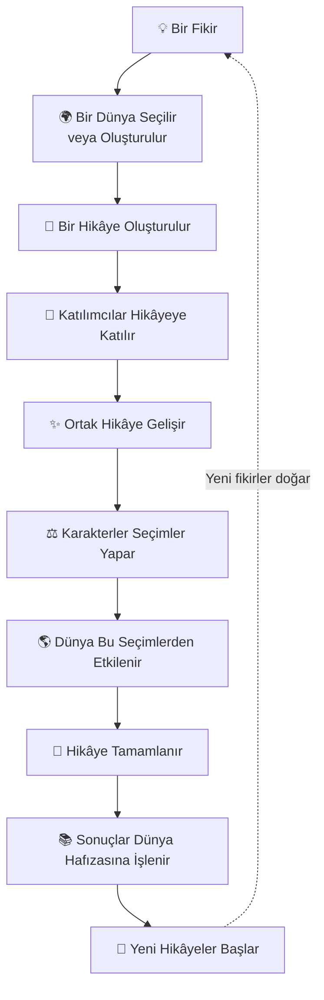
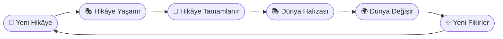

# Hikâye Yaşam Döngüsü

## Hikâye Yaşam Döngüsü

> _"Her hikâye bir fikirle başlar. Ancak gerçekten yaşayan hikâyeler, sona erdikten sonra bile dünyayı değiştirmeye devam eder."_

### Bu Bölümde

Bu bölümün sonunda;

* Bir hikâyenin Loreloom'daki yaşam döngüsünü öğreneceksiniz.
* Hikâyelerin nasıl başladığını, geliştiğini ve sona erdiğini anlayacaksınız.
* Hikâyelerin neden dünya üzerinde kalıcı etkiler bıraktığını keşfedeceksiniz.

***

### Hikâyeler Bir Süreçtir

Loreloom'da bir hikâye yalnızca yazılıp tamamlanan bir metin değildir.

Her hikâye bir fikirle doğar.

Oyuncuların katkılarıyla gelişir.

Dünyayı etkiler.

Ve sona erdiğinde bile ardında yeni hikâyelerin üzerine inşa edilebileceği bir miras bırakır.

Bu nedenle Loreloom'da hikâyeler doğrusal değil, döngüsel bir yapıya sahiptir.

***

> 📌 **Temel Kavram**
>
> **Hikâye Yaşam Döngüsü**
>
> Bir hikâyenin ortaya çıkışından başlayarak, dünya üzerinde kalıcı bir iz bırakmasına kadar geçen sürecin tamamına Hikâye Yaşam Döngüsü adı verilir.
>
> Her tamamlanan hikâye, gelecekte anlatılacak yeni hikâyelerin başlangıç noktası olabilir.

***

### Hikâye Yaşam Döngüsü

***

### 1. Bir Fikir

Her hikâye küçük bir fikirle başlar.

Bu bazen tek bir karakter olabilir.

Bazen çözülmesi gereken bir gizem.

Bazen de yalnızca şu soru:

> _"Ya şöyle olsaydı?"_

Loreloom'da hiçbir hikâyenin başlangıç biçimi diğerinden daha değerli değildir.

Önemli olan, bu fikrin birlikte gelişmeye açık olmasıdır.

***

### 2. Bir Dünya

Her hikâye bir dünyanın içinde yaşanır.

Bu dünya daha önce oluşturulmuş olabilir.

Ya da tamamen yeni bir dünya oluşturulabilir.

Dünya; hikâyenin geçtiği coğrafyayı, tarihi, kültürü ve kurallarını belirleyen ortak zemindir.

***

### 3. Hikâyenin Başlaması

Bir fikir, paylaşılabilir bir hikâyeye dönüştüğünde yaşam döngüsü resmen başlar.

Bu aşamada hikâyenin amacı, tonu ve kapsamı belirlenir.

Artık diğer oyuncular da bu anlatının bir parçası olabilir.

***

### 4. Ortak Anlatı

Katılımcılar kendi karakterleriyle hikâyeye dâhil olur.

Her oyuncu yalnızca kendi karakterini yönetir.

Ancak karakterlerin etkileşimleri, ortak anlatının yönünü belirler.

Hiçbir gelişme tek bir kişinin kontrolünde değildir.

Hikâye, tüm katkıların doğal birleşiminden doğar.

> 💡 **Tasarım İlkesi**
>
> Loreloom'da hikâyeler yazılmaz.
>
> Hikâyeler yaşanır.
>
> Oyuncular yalnızca kendi seçimlerini yapar.
>
> Anlatı ise bu seçimlerin kesişiminden oluşur.

***

### 5. Dünyaya Etki

Her hikâye dünyada bir iz bırakır.

Bir şehir kurulabilir.

Bir lonca yükselebilir.

Bir hükümdar değişebilir.

Yeni bir gelenek doğabilir.

Ya da eski bir uygarlık tamamen yok olabilir.

Loreloom'da yaşanan hiçbir önemli olay tamamen unutulmaz.

***

### 6. Hikâyenin Sonu

Her hikâyenin bir sonu vardır.

Ancak bu son, dünyanın sonu değildir.

Karakterler yollarına devam edebilir.

Yeni hikâyeler başlayabilir.

Eski olaylar yeni anlatılara ilham verebilir.

Bir hikâyenin bitmesi, yalnızca o anlatının tamamlandığı anlamına gelir.

***

### 7. Dünya Hafızası

Loreloom'un en önemli özelliklerinden biri, dünyaların hafızaya sahip olmasıdır.

Tamamlanan hikâyeler kaybolmaz.

Önemli olaylar, kişiler, kuruluşlar ve değişimler dünyanın tarihinin bir parçası hâline gelir.

Bu sayede gelecek hikâyeler, geçmişte yaşanan olaylardan beslenebilir.

***

> 🎯 **Amaç**
>
> Hikâye Yaşam Döngüsü'nün amacı, her hikâyeyi tek kullanımlık bir deneyim olmaktan çıkarmaktır.
>
> Loreloom'da her tamamlanan hikâye, gelecekte anlatılacak yeni hikâyeler için bir temel oluşturur.
>
> Bu yaklaşım, dünyaların zaman içinde organik olarak büyümesini sağlar.

***

### Hikâyeler Döngü Oluşturur

Bir hikâyenin tamamlanması, Loreloom'da anlatının sona erdiği anlamına gelmez.

Tamamlanan her hikâye dünyanın hafızasına eklenir. Bu hafıza, gelecekte başlayacak yeni hikâyeler için yeni fırsatlar, yeni çatışmalar ve yeni başlangıç noktaları oluşturur.

Bu nedenle Loreloom'da hikâyeler doğrusal değil, birbirini besleyen döngüsel bir yapı oluşturur.

> 💡 **Hatırlatma**
>
> Loreloom'da önemli olan yalnızca bir hikâyenin nasıl sona erdiği değildir.
>
> Asıl önemli olan, o hikâyenin dünyaya nasıl bir miras bıraktığı ve gelecekte anlatılacak yeni hikâyeleri nasıl etkilediğidir.

***

> 🧩 **Örnek**
>
> Bir grup oyuncu küçük bir liman kasabasını korsanlardan kurtarır.
>
> Hikâye sona erer.
>
> Aylar sonra başka oyuncular aynı dünyada yeni bir hikâye başlatır.
>
> Kasaba artık büyümüştür.
>
> Liman genişlemiştir.
>
> Korsan saldırıları tarihe karışmıştır.
>
> İlk hikâyedeki oyuncular artık oyunda olmasa bile, bıraktıkları miras yaşamaya devam eder.
>
> İşte Loreloom'un Hikâye Yaşam Döngüsü tam olarak bunu ifade eder.

***

### Bölüm Özeti

Loreloom'da her hikâye;

* bir fikirle başlar,
* bir dünyada hayat bulur,
* oyuncuların seçimleriyle gelişir,
* dünyayı değiştirir,
* sona erdiğinde bile ardında kalıcı bir miras bırakır.

Bu döngü sayesinde Loreloom'daki dünyalar sürekli gelişir ve her yeni hikâye, geçmişin üzerine inşa edilir.

***

### ✔ Bu Bölümün Ardından

Bu bölümü tamamladıysanız;

* ☑ Bir hikâyenin Loreloom'daki yaşam döngüsünü açıklayabilirim.
* ☑ Hikâyelerin neden döngüsel bir yapıya sahip olduğunu anlıyorum.
* ☑ Dünya Hafızası kavramının önemini biliyorum.
* ☑ Hikâyelerin yalnızca sona ermediğini, geleceği de şekillendirdiğini kavradım.

Bir sonraki bölümde, bu yaşam döngüsünün merkezinde yer alan **Oturum Sistemi**ni inceleyecek ve bir hikâyenin aktif olarak nasıl deneyimlendiğini öğreneceğiz.
