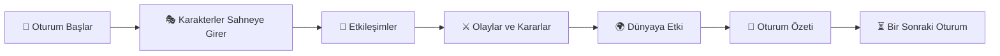

# Oturum Sistemi

## Oturum Sistemi

> _"Bir hikâye sürekli açık olabilir. Ancak unutulmaz anlar, aynı anda aynı hikâyeyi yaşayan insanların bir araya geldiği oturumlarda doğar."_

### Bu Bölümde

Bu bölümün sonunda;

* Oturum kavramının ne olduğunu anlayacaksınız.
* Oturumların neden Loreloom'un temel yapı taşlarından biri olduğunu öğreneceksiniz.
* Bir hikâyenin oturumlar aracılığıyla nasıl ilerlediğini keşfedeceksiniz.

***

### Oturum Nedir?

Loreloom'da bir hikâye günler, haftalar hatta aylar boyunca varlığını sürdürebilir.

Ancak hikâyenin aktif olarak ilerlediği zaman dilimleri **oturum** olarak adlandırılır.

Bir oturum, belirlenen gün ve saatte katılımcıların aynı hikâyede buluşarak birlikte anlatıyı ilerlettiği planlı bir buluşmadır.

Oturumlar, ortak hikâyenin en canlı ve en etkileşimli anlarını oluşturur.

***

### 📌 Temel Kavram

#### Oturum

Bir hikâyenin, belirlenen tarih ve saatte katılımcılar tarafından eş zamanlı olarak oynanan bölümüdür.

Her oturum, hikâyenin doğal akışının bir parçasıdır.

Bir hikâye birçok oturumdan oluşabilir.

***

### Oturumların Amacı

Loreloom'da oturumların amacı yalnızca oyuncuları aynı anda çevrimiçi buluşturmak değildir.

Asıl amaç;

* kararların birlikte alınmasını,
* karakterlerin gerçek zamanlı etkileşime girmesini,
* olayların doğal bir akış içinde gelişmesini sağlamaktır.

Böylece hikâye daha canlı, daha sürükleyici ve daha ortak bir deneyime dönüşür.

***

### Hikâye ve Oturum İlişkisi

Bir hikâye tek bir oturumdan oluşabileceği gibi onlarca oturuma da yayılabilir.

Her oturum;

* yeni olaylar başlatabilir,
* devam eden olayları ilerletebilir,
* mevcut hikâyeyi sonlandırabilir.

Oturumlar birbirinden bağımsız değildir.

Her biri, aynı hikâyenin farklı bir bölümünü temsil eder.

***

### 💡 Tasarım İlkesi

Loreloom'da oturumlar, hikâyeyi bölmek için değil; ortak deneyimi güçlendirmek için vardır.

Oyuncular aynı zamanı paylaşabildiğinde, hikâye çok daha doğal ve güçlü şekilde gelişir.

***

### Oturum Akışı

Her oturum genel olarak aşağıdaki akışı takip eder.

***

### Oturum Sonu

Her oturumun sonunda hikâye tamamen bitmek zorunda değildir.

Oturum sonunda;

* önemli olaylar kaydedilir,
* alınan kararlar özetlenir,
* dünyanın hafızası güncellenir,
* bir sonraki oturum için yeni başlangıç noktaları oluşur.

Bu sayede uzun soluklu hikâyeler düzenli ve takip edilebilir şekilde ilerler.

***

### Düzenli Takvim

Loreloom'da her hikâyenin kendi oturum takvimi bulunur.

Bu takvim hikâyeyi oluşturan ekip tarafından belirlenir.

Örneğin;

* Her Cumartesi 20.00
* Pazartesi ve Perşembe 21.30
* Ayda bir Pazar günü

gibi farklı düzenler tercih edilebilir.

Önemli olan, katılımcıların bu zamanları önceden bilmesidir.

***

### Esneklik

Gerçek hayat her zaman önceliklidir.

Her oyuncu her oturuma katılamayabilir.

Loreloom'un amacı oyuncuları cezalandırmak değil, sürdürülebilir bir ortak hikâye oluşturmaktır.

Bu nedenle hikâyeler, eksik katılımcılar olsa bile devam edebilecek şekilde tasarlanmalıdır.

***

### 🎯 Amaç

Oturum Sistemi'nin amacı, oyuncuların aynı anda aynı hikâyeyi deneyimleyebilecekleri ortak bir zaman oluşturmaktır.

Bu yapı;

* iletişimi güçlendirir,
* kararları hızlandırır,
* ortak hikâyeyi daha doğal hâle getirir.

***

### 🧩 Örnek

Bir grup oyuncu her Çarşamba akşamı saat 20.30'da buluşmaktadır.

Bir oturumda karakterler kayıp bir tapınağı keşfeder.

Oturum sona erdiğinde tapınak henüz tamamen araştırılmamıştır.

Bir sonraki hafta aynı hikâye kaldığı yerden devam eder.

Bu süreç boyunca her oturum, büyük hikâyenin yalnızca bir bölümünü oluşturur.

***

### Bölüm Özeti

Loreloom'da hikâyeler oturumlar aracılığıyla deneyimlenir.

Her oturum, ortak hikâyenin belirli bir bölümünü temsil eder.

Oturumlar planlıdır, eş zamanlıdır ve hikâyenin doğal gelişimini desteklemek için tasarlanmıştır.

Bir hikâye tek bir oturumda bitebilir veya aylar boyunca devam eden birçok oturumdan oluşabilir.

***

### ✔ Bu Bölümün Ardından

Bu bölümü tamamladıysanız;

* ☑ Oturum kavramını açıklayabilirim.
* ☑ Hikâye ile oturum arasındaki farkı biliyorum.
* ☑ Oturumların neden planlı olduğunu anlıyorum.
* ☑ Bir hikâyenin birçok oturumdan oluşabileceğini biliyorum.

Bir sonraki bölümde, bu oturumların içinde yer alan kişilerin sorumluluklarını inceleyecek ve **Roller** ile tanışacağız.
