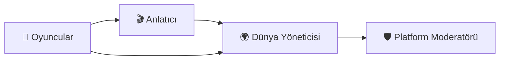

# Roller

## Roller

> _"Her ortak hikâye farklı sorumluluklar üstlenen insanların birlikte çalışmasıyla hayat bulur."_

### Bu Bölümde

Bu bölümün sonunda;

* Loreloom'daki temel rolleri tanıyacaksınız.
* Her rolün sorumluluklarını anlayacaksınız.
* Rollerin birbirini nasıl tamamladığını öğreneceksiniz.

***

### Roller Neden Vardır?

Loreloom'da herkes hikâyeye katkı sağlar.

Ancak herkes aynı sorumluluğu üstlenmez.

Bazı katılımcılar karakterlerini canlandırır.

Bazıları hikâyenin akışını yönetir.

Bazıları ise dünyaların uzun vadeli tutarlılığını korur.

Bu görev dağılımı, ortak hikâyelerin düzenli ve sürdürülebilir şekilde ilerlemesini sağlar.

***

> 📌 **Temel Kavram**
>
> **Rol**
>
> Bir kullanıcının, bir hikâye veya dünya içerisindeki sorumluluğunu ifade eder.
>
> Bir rol, oyuncunun yaratıcılığını sınırlandırmaz; yalnızca üstlendiği görevleri tanımlar.

***

### 👤 Oyuncu

Oyuncu, Loreloom'un merkezindeki kişidir.

Her oyuncu, oluşturduğu karakter aracılığıyla hikâyeye katılır.

Oyuncular;

* kendi karakterlerini canlandırır,
* karakterlerinin kararlarını verir,
* diğer oyuncularla etkileşime girer,
* ortak hikâyenin gelişimine katkıda bulunur.

#### Oyuncunun Sorumlulukları

* Yalnızca kendi karakterini yönetmek.
* Ortak hikâyeye katkı sağlamak.
* Diğer oyuncuların anlatım alanına saygı göstermek.
* Hikâyenin tonuna ve kurallarına uyum sağlamak.

> 💡 **Tasarım İlkesi**
>
> Oyuncular hikâyeyi tüketmez.
>
> Hikâyeyi birlikte oluştururlar.

***

### 🎬 Anlatıcı

Anlatıcı, bir hikâyenin akışını organize eden kişidir.

Anlatıcı'nın görevi hikâyeyi yazmak değildir.

Görevi, oyuncuların seçimlerine tepki veren yaşayan bir dünya sunmaktır.

Anlatıcı;

* sahneleri başlatır,
* çevreyi betimler,
* oyuncuların karşılaştığı olayları yönetir,
* dünyanın tepkilerini aktarır.

Anlatıcı, oyuncular adına karar vermez.

Oyuncuların kararlarının sonuçlarını görünür hâle getirir.

#### Anlatıcının Sorumlulukları

* Hikâyeyi organize etmek.
* Sahneleri hazırlamak.
* Dünyanın tepkilerini tarafsız biçimde aktarmak.
* Oyuncuların katkılarını desteklemek.
* Hikâyenin akışını sürdürülebilir kılmak.

> 💡 **Tasarım İlkesi**
>
> Anlatıcı, hikâyenin sahibi değildir.
>
> Hikâyenin kolaylaştırıcısıdır.

***

### 🌍 Dünya Yöneticisi

Bazı dünyalarda aynı anda birden fazla hikâye devam edebilir.

Bu durumda dünyadaki büyük ölçekli değişimlerin takip edilmesi gerekir.

Dünya Yöneticisi;

* dünya tarihini korur,
* önemli olayları kayıt altına alır,
* farklı hikâyeler arasındaki tutarlılığı gözetir.

Bu rol, tek bir hikâyeyi değil, dünyanın bütününü destekler.

> **Not**
>
> Dünya Yöneticisi her dünyada bulunmak zorunda değildir.
>
> Küçük veya bağımsız dünyalarda bu sorumluluk Anlatıcı tarafından da üstlenilebilir.

***

### 🛡 Platform Moderatörü

Platform Moderatörü, oyun içindeki hikâyelerden değil, Loreloom topluluğundan sorumludur.

Görevleri arasında;

* topluluk kurallarının uygulanmasını sağlamak,
* güvenli bir ortam oluşturmak,
* kullanıcılar arasındaki anlaşmazlıklarda destek sunmak

yer alır.

Bu rol, hikâye anlatımının değil, platformun sürdürülebilirliğini destekler.

***

### Roller Birlikte Çalışır

Loreloom'da roller birbirinin alternatifi değildir.

Her biri farklı bir sorumluluk üstlenir.

* Oyuncular hikâyeyi oluşturur.
* Anlatıcı hikâyenin akışını yönetir.
* Dünya Yöneticisi dünyanın sürekliliğini korur.
* Platform Moderatörü ise bütün topluluğun güvenliğini destekler.

***

> 💡 **Bir Kullanıcı Birden Fazla Rol Üstlenebilir**
>
> Loreloom'da roller kullanıcıya değil, üstlenilen sorumluluklara bağlıdır.
>
> Bu nedenle bir kullanıcı aynı anda birden fazla rol üstlenebilir.
>
> Örneğin;
>
> * Bir kullanıcı hem **Oyuncu** hem **Anlatıcı** olabilir.
> * Bir **Dünya Yöneticisi**, aynı zamanda kendi dünyasında **Oyuncu** olarak yer alabilir.
> * Bir kullanıcı farklı hikâyelerde farklı roller üstlenebilir.
>
> Önemli olan, her rolün sorumluluklarını bulunduğu bağlam içinde doğru şekilde yerine getirmesidir.
>
> 🎯 **Temel İlke**
>
> Loreloom'da kullanıcılar değil, roller yetki ve sorumluluk taşır.

***

> 🎯 **Amaç**
>
> Loreloom'daki rollerin amacı yetki dağıtmak değildir.
>
> Amaç, ortak hikâye üretiminde herkesin sorumluluğunu açık biçimde tanımlamaktır.
>
> Her rol, Beş İlke'yi destekleyecek şekilde tasarlanmıştır.

***

> 🧩 **Örnek**
>
> Bir grup oyuncu yeni bir hikâyeye başlar.
>
> Oyuncular karakterlerini canlandırırken, Anlatıcı şehrin atmosferini ve karşılaştıkları olayları betimler.
>
> Hikâye sona erdiğinde Dünya Yöneticisi bu olayları dünya tarihine ekler.
>
> Platform Moderatörü ise yalnızca topluluk düzeniyle ilgilenir; hikâyenin gidişatına müdahale etmez.
>
> Bu görev paylaşımı sayesinde herkes kendi sorumluluğuna odaklanabilir.

***

### Bölüm Özeti

Loreloom'da dört temel rol bulunur.

* 👤 Oyuncu
* 🎬 Anlatıcı
* 🌍 Dünya Yöneticisi
* 🛡 Platform Moderatörü

Bu roller, ortak hikâyenin sürdürülebilir ve düzenli biçimde ilerlemesini sağlamak için birlikte çalışır.

***

### ✔ Bu Bölümün Ardından

Bu bölümü tamamladıysanız;

* ☑ Loreloom'daki temel rolleri tanıyorum.
* ☑ Her rolün sorumluluklarını açıklayabilirim.
* ☑ Roller arasındaki farkları biliyorum.
* ☑ Ortak hikâyenin neden görev paylaşımı gerektirdiğini anlıyorum.

Bir sonraki bölümde, kitap boyunca kullanılan temel terimleri bir araya getirecek olan **Loreloom Sözlüğü** bölümüne geçeceğiz.
